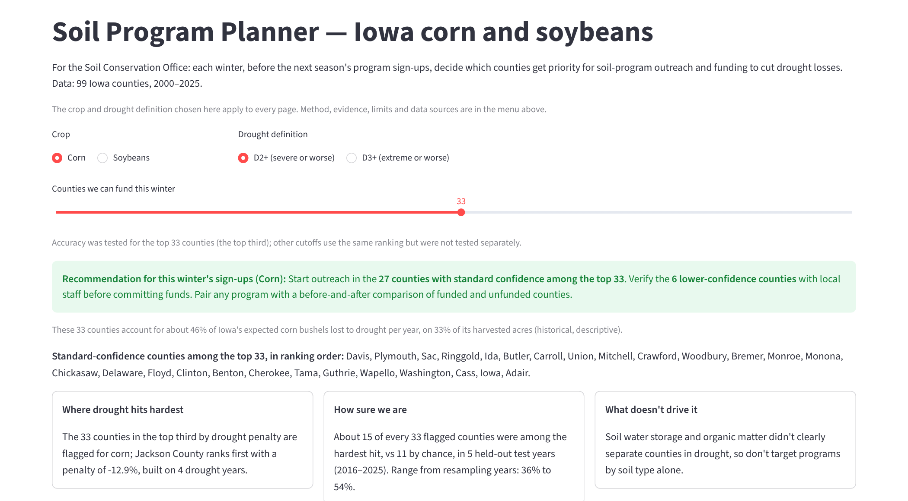
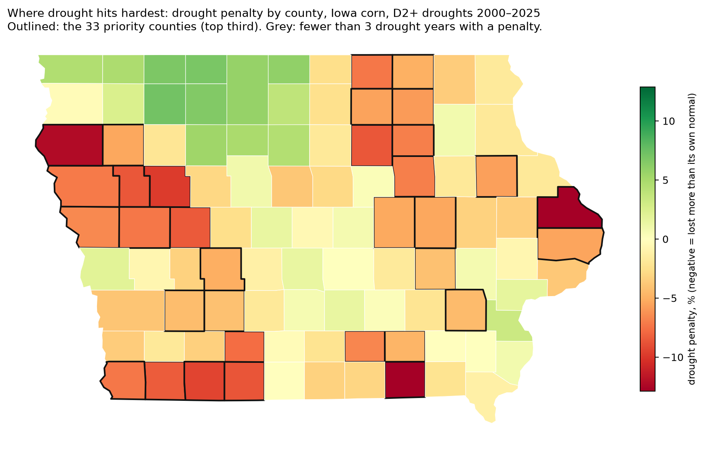
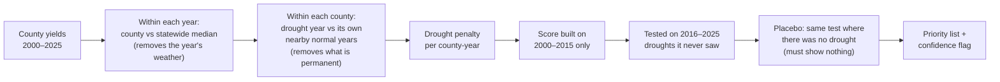

<h1 align="center">Soil Program Planner</h1>

<p align="center">
  <b>Which Iowa counties should a soil conservation office prioritize this winter to cut drought losses?</b><br>
  A tested, county-level priority list for corn and soybeans, built from 26 years of yields, drought maps and soil surveys.
</p>

<p align="center">
  <a href="https://team-shark-soil-planner.streamlit.app"></a>
  
  
  <a href="LICENSE"></a>
  
</p>

<p align="center">
  <a href="https://team-shark-soil-planner.streamlit.app"><b>▶ Open the live app</b></a> · no install needed
</p>

<p align="center">
  
</p>

**Team Shark** · Data to Harvest Hackathon, Delaware State University, October 17–18, 2026

## Contents

- [What it does](#what-it-does)
- [Main result](#main-result)
- [Try it](#try-it)
- [App pages](#app-pages)
- [How it works](#how-it-works)
- [Limits](#limits)
- [Repository map](#repository-map)
- [Reproducing the analysis](#reproducing-the-analysis)
- [Troubleshooting](#troubleshooting)
- [Extra data](#extra-data)
- [Acknowledgments](#acknowledgments)
- [Data sources and credits](#data-sources-and-credits)
- [Team](#team)

## What it does

Each winter, before the next season's program sign-ups, a **Soil Conservation Office** has to decide which Iowa counties get priority for soil-program outreach and funding to cut drought losses. The planner:

- **ranks the 99 Iowa counties** by how much more they lost in past droughts than in their own normal years (the *drought penalty*),
- **shows the evidence** that this ranking predicts losses in droughts it had never seen,
- **flags counties** whose score rests on few drought years, so staff verify them locally first,
- **shows each county's soil and current conservation practices** as context.

Corn and soybeans are handled separately. Rain-fed Iowa only, 2000–2025.

<p align="center">
  
</p>

## Main result

| Finding | What the data showed |
| --- | --- |
| **The drought-penalty ranking beats chance on unseen droughts** | Built on 2000–2015 and tested on the 2016–2025 drought years, about **45% (corn)** and **49% (soybeans)** of the counties it ranked in the top third were among the hardest hit, against 33% by chance: roughly 15 to 16 of every 33 flagged counties, against 11 by chance. The corn ranking held up in every test year; the soybean ranking was less consistent. |
| **Soil water storage shows no clear effect** | It leans toward smaller losses, but every estimate's range includes zero, and Iowa's storage range is narrow and entangled with region, so we don't recommend targeting programs by storage alone. |
| **Organic matter shows no clear effect** | Under a pre-registered decision rule (notebook 07). |
| **A Nebraska replication was not testable** | Irrigation leaves only 13–18 mostly rain-fed counties, below our pre-set minimum of 20, so the pre-registered plan stopped at its feasibility gate (notebook 06). |

## Try it

**Online:** [team-shark-soil-planner.streamlit.app](https://team-shark-soil-planner.streamlit.app). The app sleeps after a few days without visitors; the first open then takes about a minute.

**Locally** (Python 3.11 to 3.13), from the repository root:

```bash
python3 -m venv .venv
source .venv/bin/activate            # Windows (PowerShell): .venv\Scripts\Activate.ps1
python -m pip install -r requirements.txt
python -m streamlit run soil_planner/app.py
```

The first load takes a few seconds while the drought penalties and the held-out test are computed; after that every setting change is instant.

**As a report:** `notebooks/Soil_Program_Planner.ipynb` calls the same functions as the app, so both show the same numbers. To re-run it without opening it:

```bash
jupyter nbconvert --to notebook --execute --inplace notebooks/Soil_Program_Planner.ipynb
```

## App pages

The crop and drought definition chosen at the top apply to every page.

| Menu | Page | What it shows |
| --- | --- | --- |
| **Plan** | This winter's plan | The recommendation for the counties to fund, the standard-confidence county list, three insight cards and the priority list with a CSV download. |
| | County explorer | A county map with a metric selector and the funded counties outlined; click a county for its penalty, rank, confidence, soil context, current practices, reasons and year-by-year chart. |
| **Evidence** | How we know it works | The scorecard, the held-out proof chart, the held-out and placebo tables, and the earlier attempts we moved on from. |
| | How we got here | The project story and the methods note. |
| **Reference** | Limits and next steps | What the evidence can and cannot say, and what to test once programs are funded. |
| | About and data sources | The data behind the tool and the credits. |

The "Counties we can fund this winter" slider on the plan page defaults to **33**, the top third, which is the cutoff that was tested. Other cutoffs use the same ranking but were not tested separately.

## How it works



Every comparison is made within a year, so counties are only ever compared with other counties under the same season's weather. A county's drought penalty is how far its drought-year yield fell below its own nearby normal years, after removing that year's statewide drop, so anything permanent about a county cancels out. The score was built on 2000–2015 only and tested on the 2016–2025 drought years it had never seen, with resampled years giving the ranges. The same test was run where it should find nothing, in the non-drought counties of every test year, and the score showed nothing there; our first, trend-based attempt failed that placebo check and was discarded. The Nebraska replication and the soil-and-practices test were pre-registered: their plans were committed before any result existed (commits `2bc1c15` and `dd6722b`), and the results are reported whatever they turned out to be.

## Limits

- **Association, not program effect.** The ranking shows where drought has hurt most, not where a soil program would help most. Nothing here estimates what a program would do.
- **Few test years, no statewide drought among them.** The held-out test rests on 5 to 7 drought years, all partial-state events; no 2012-scale drought is in the test set, and the ranges are wide for that reason.
- **Scoped to rain-fed Iowa, 2000–2025.** Future droughts, new practices or other states may not behave the same way, and the Nebraska replication could not be run.

The full list is on the app's *Limits and next steps* page.

## Repository map

```
soil_planner/            the planner
├── app.py               Streamlit entrypoint: shared controls and navigation
├── soil_tool.py         the engine: drought penalty, ranking, held-out test, placebo checks, all notes
├── app_common.py        cached calls, labels and helpers shared by the pages
├── pages_app/           the six pages
├── extra_data/          extra soil properties and practice shares, context only (see its README)
└── pulls/               scripts that pulled the extra data from USDA NRCS and USDA NASS
notebooks/               the analysis, in order (01 → 07), plus the report notebook
soil_priority_extras.py  a teammate's exploratory bushel-weighted analysis (not used for the ranking)
data/, src/              the master dataset and loaders provided by the organizers, unchanged
docs/                    the organizers' briefing material, the original hackathon README, images
```

<details>
<summary><b>The notebooks, one line each</b></summary>

| Notebook | What it does |
| --- | --- |
| `01_coverage_checks` | How complete yield reporting and drought exposure are by state and crop; settles on Iowa corn and soybeans. |
| `02_storage_groups` | Defines low, middle and high soil-water-storage groups and checks whether they are fair to compare (region, drought exposure, heat). |
| `03_storage_effect` | In-sample estimate of whether more storage goes with smaller drought-year losses; no clear effect. |
| `04_priority_ranking_test` | First held-out ranking test, built on a 2000–2015 trend; it failed its placebo check and was abandoned. |
| `05_drought_penalty` | The drought-penalty score, its held-out test on 2016–2025 and its placebo checks; the method the app uses. |
| `06_nebraska_replication` | Pre-registered replication on Nebraska's rain-fed counties; stopped at the feasibility gate. |
| `07_soil_and_practices` | Pre-registered test of organic matter, other soil properties and conservation-practice shares against the drought penalty; no clear effect. |
| `Soil_Program_Planner` | The report version of the app, same functions and numbers. |

</details>

## Reproducing the analysis

The notebooks `01` to `07` run in order. From the repository root, for each one:

```bash
jupyter nbconvert --to notebook --execute --inplace --ExecutePreprocessor.timeout=600 notebooks/05_drought_penalty.ipynb
```

They write no files; each notebook's results are the tables and verdicts inside it.

- `05_drought_penalty` produces the drought penalty for every county-year, its held-out ranking test (scores from 2000–2015, tested on the 2016–2025 drought years) with the placebo checks, and the storage estimate with ranges.
- `06_nebraska_replication` (pre-registered) produces the feasibility gate for Nebraska's rain-fed counties and, for any crop that passes it, the same replication; both crops stopped at the gate.
- `07_soil_and_practices` (pre-registered) produces the primary test of surface organic matter against the drought penalty, the exploratory soil-property and conservation-practice tests, and the verdict under the rules fixed in advance.

## Troubleshooting

<details>
<summary><b><code>No module named 'src'</code> or <code>'soil_planner'</code></b></summary>

Run every command from the repository root. From anywhere else, Python cannot find the `src` or `soil_planner` packages.

</details>

<details>
<summary><b><code>pip install</code> fails on numpy</b></summary>

Use Python 3.11 to 3.13. The pinned numpy needs 3.11 or newer; delete `.venv` and create it again with a newer Python.

</details>

## Extra data

The app uses the files already in `soil_planner/extra_data/` (see [its README](soil_planner/extra_data/README.md) for their sources, dates and methods). Re-pulling them with the scripts in `soil_planner/pulls/` is optional. The conservation-practices pull needs a free [NASS Quick Stats key](https://quickstats.nass.usda.gov/api) in a `.env` file at the repository root (`NASS_API_KEY=your_key_here`), which `.gitignore` excludes; the soil pull needs no key. Never commit keys.

## Acknowledgments

Built at the Data to Harvest: AI for Agricultural Resilience Hackathon (Delaware State University, Oct 17–18, 2026), organized by MS-CC with support from the National Science Foundation (Grant #2234326). Original hackathon instructions: [docs/HACKATHON_README.md](docs/HACKATHON_README.md).

Methods draw on Bueno de Mesquita & Fowler, *Thinking Clearly with Data* (2021); Gelman, Hill & Vehtari, *Regression and Other Stories* (2020); and Pearl & Mackenzie, *The Book of Why* (2018).

## Data sources and credits

Credit the sources when presenting results from this data (wording from the hackathon README):

- **USDA NASS Quick Stats** (county yields; Census of Agriculture conservation practices): This product uses the NASS API but is not endorsed or certified by NASS.
- **NOAA ACIS** (weather): Weather data from the Applied Climate Information System (ACIS), NOAA Regional Climate Centers.
- **U.S. Drought Monitor** (drought): The U.S. Drought Monitor is jointly produced by the National Drought Mitigation Center at the University of Nebraska-Lincoln, the United States Department of Agriculture, and the National Oceanic and Atmospheric Administration.
- **USDA NRCS SSURGO / Soil Data Access** (soil): Soil Survey Staff, Natural Resources Conservation Service, United States Department of Agriculture. Soil Survey Geographic (SSURGO) Database, via Soil Data Access.
- **Data to Harvest hackathon master dataset** (Delaware State University, October 2026): the county x crop x year table that combines the sources above.

From the original hackathon README, for the other sources in the repository:

- **MODIS:** Didan, K. (2021). MODIS/Terra Vegetation Indices 16-Day L3 Global 250m SIN Grid V061. NASA EOSDIS Land Processes DAAC. https://doi.org/10.5067/MODIS/MOD13Q1.061
- **County boundaries** (`data/counties.geojson`): U.S. Census Bureau county boundaries, from the [plotly/datasets](https://github.com/plotly/datasets) county GeoJSON.

The code and documentation in this repo are under the [MIT License](LICENSE).

## Team

| Name | GitHub |
| --- | --- |
| Lorenzo | [RenzoRamirez26](https://github.com/RenzoRamirez26) |
| Maria Gomez Jacome | [cjgomez14](https://github.com/cjgomez14) |
| Orlando Hernandez | [Orlando-Hernandez](https://github.com/Orlando-Hernandez) |
| Alba Benedito | [albabc2020-hub](https://github.com/albabc2020-hub) |
| Nitya Shah | [Nitya485-nyb](https://github.com/Nitya485-nyb) |

<p align="right"><a href="#soil-program-planner">back to top ↑</a></p>
